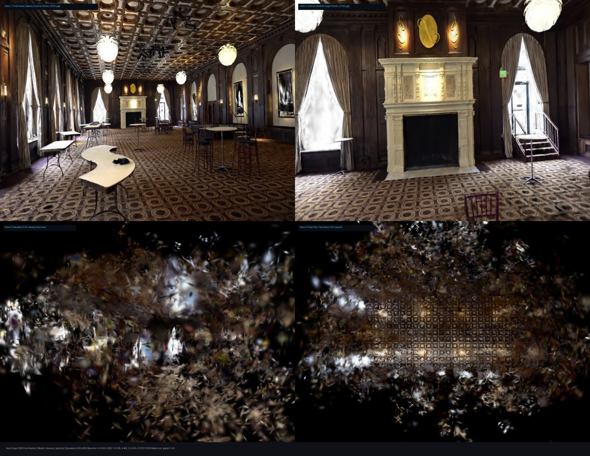
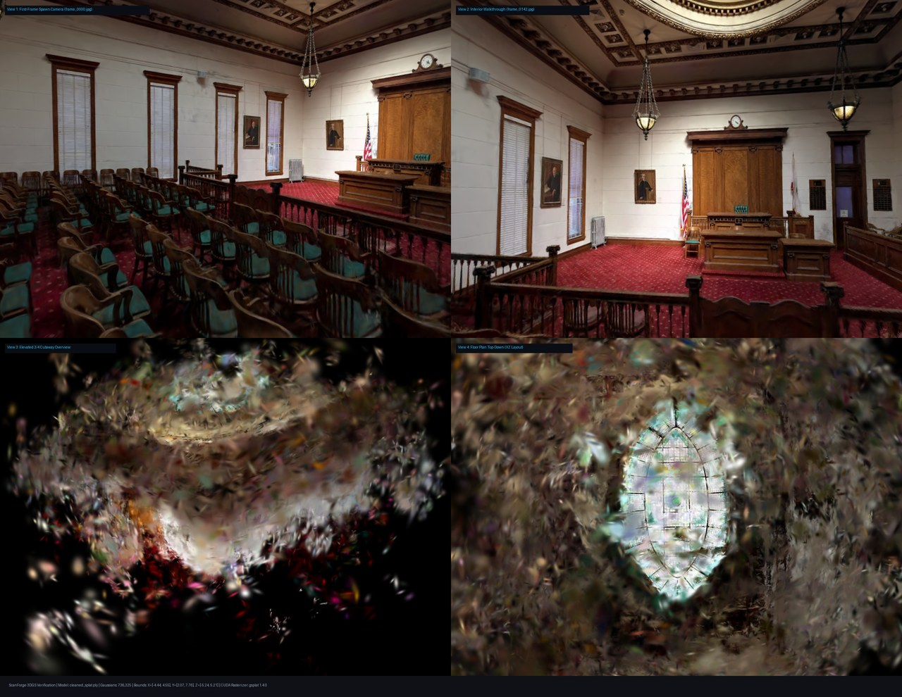
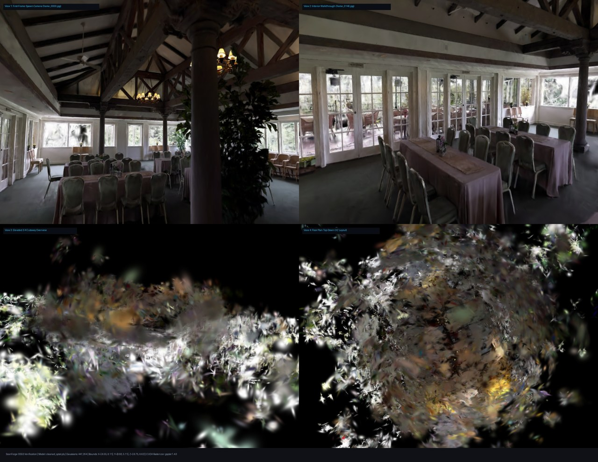
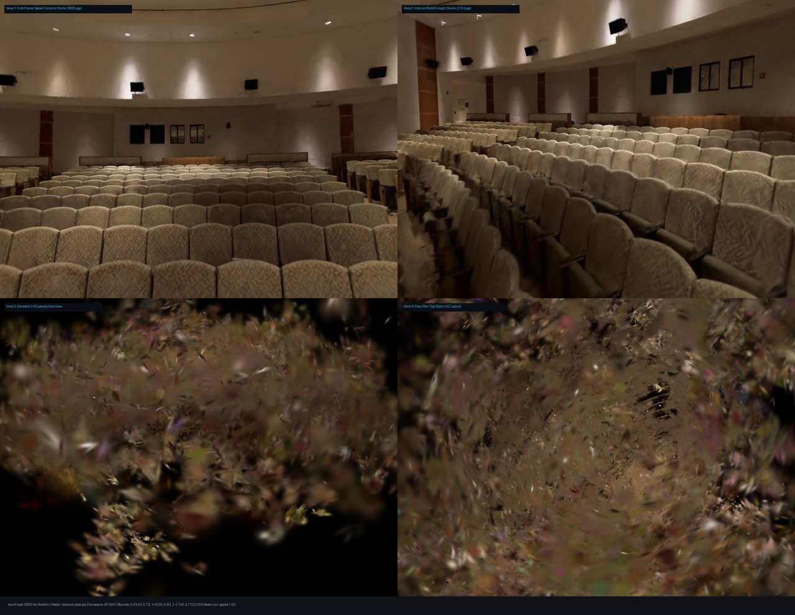
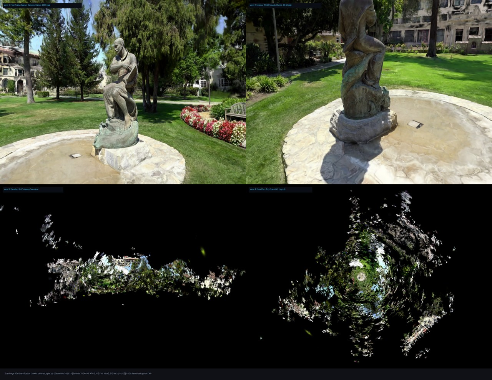
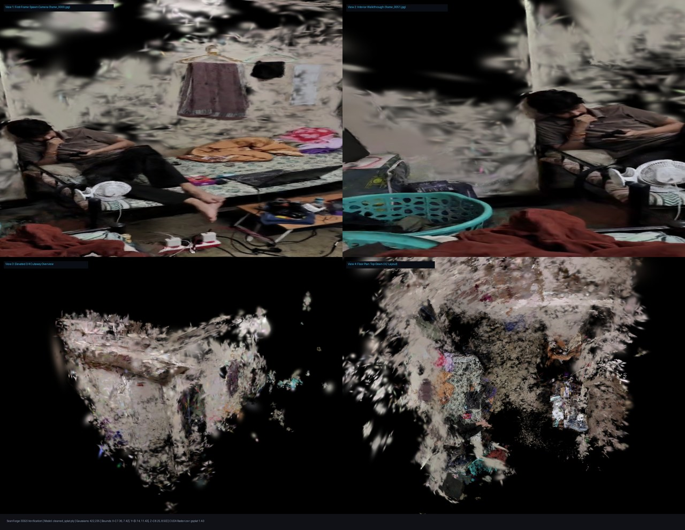
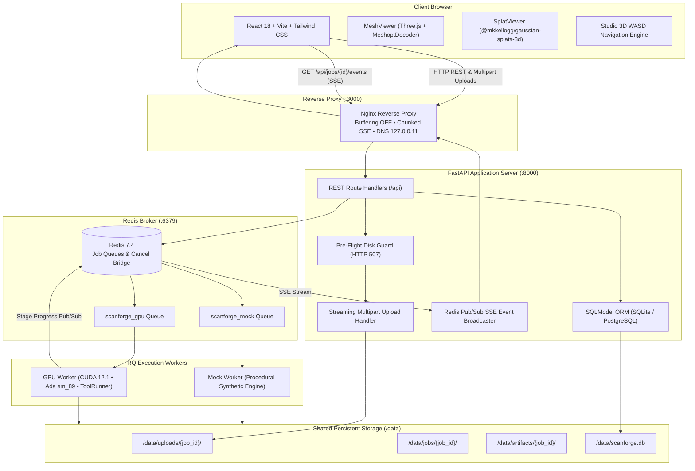
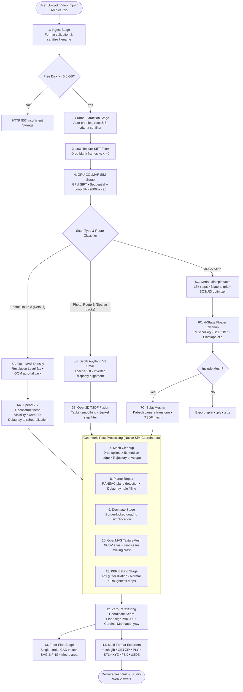
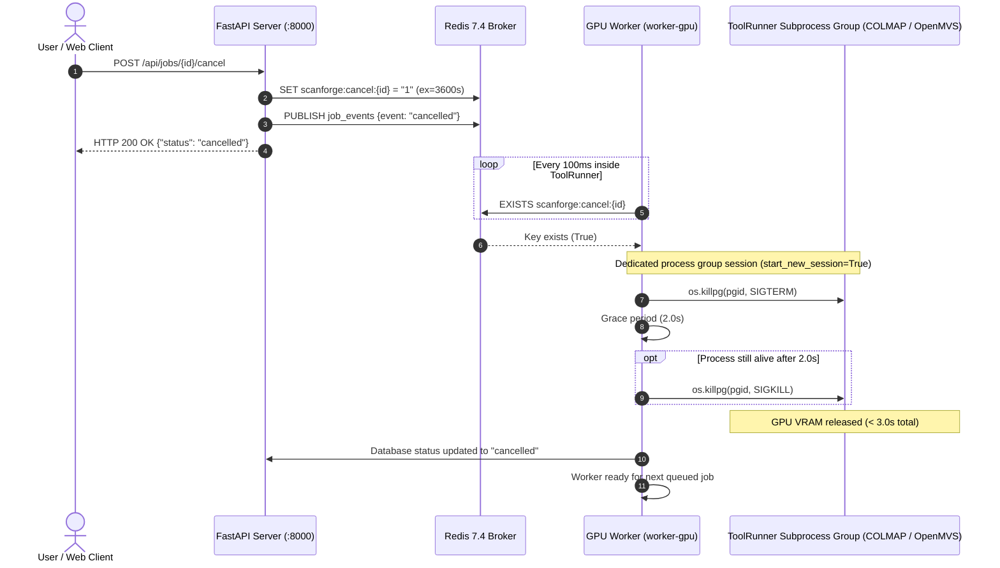

# ScanForge

> **Autonomous, Self-Hostable 3D Reconstruction Studio for Interiors & Architecture**  
> Turn everyday smartphone video walk-throughs and RGB-D captures into clean, watertight PBR meshes, photorealistic 3D Gaussian Splats, and 2D architectural CAD floor plans.  
>  
> **Built by**: **Om Mali**, **Neel Patil**, and **Shreyash Olambe**

[](docs/LICENSES.md)
[-green.svg)](AGENTS.md)
[](docs/ARCHITECTURE.md)
[](progress.md)
[](progress.md)
[](docker-compose.yml)

---

## Table of Contents

1. [Executive Summary & Core Value](#1-executive-summary--core-value)
2. [Core Engineering Innovations](#2-core-engineering-innovations)
3. [System Architecture & Topology](#3-system-architecture--topology)
4. [Reconstruction Pipeline & Data Flow](#4-reconstruction-pipeline--data-flow)
5. [Process Lifecycle, Cancellation & Crash Recovery](#5-process-lifecycle-cancellation--crash-recovery)
6. [Hardware Target & 8 GB VRAM Budget Rules](#6-hardware-target--8-gb-vram-budget-rules)
7. [Scan Types & Quality Presets](#7-scan-types--quality-presets)
8. [Deliverables Vault & Export Formats](#8-deliverables-vault--export-formats)
9. [API Specification & Endpoints](#9-api-specification--endpoints)
10. [Empirical Verification & Benchmark Results](#10-empirical-verification--benchmark-results)
11. [Quick Start & Operations](#11-quick-start--operations)
12. [Repository Structure](#12-repository-structure)
13. [Licensing & Compliance Notices](#13-licensing--compliance-notices)
14. [Authors & Core Team](#14-authors--core-team)

---

## 1. Executive Summary & Core Value

Reconstructing production-grade 3D assets of interior spaces from video presents a notorious engineering challenge:
- **Photogrammetry (SfM + MVS)** excels at sharp edges on textured furniture and mouldings, but catastrophically fails on uniform, featureless painted drywall or specular floors, leaving gaping topological holes.
- **Screened Poisson Meshing** attempts mathematical closure across unobserved boundaries, resulting in bulbous "ceiling balloons" that inflate interior rooms to over three times their actual height.
- **3D Gaussian Splatting (3DGS)** delivers real-time novel-view photorealism with view-dependent reflections, but produces massive uncompressed payloads (~236 bytes/primitive, >700 MB/scene), floating mist, and no native physical surface collision.
- **Scale Ambiguity**: Pure monocular video captures have an arbitrary scale and unaligned gravity axes.

**ScanForge resolves this tension through a unified, cross-modal interior reconstruction engine**:
- **Dual-Route Architecture**: Automatically chooses between **Route A (Photogrammetry via OpenMVS Delaunay tetrahedralization)** and **Route B (Monocular Depth Fusion via Apache-2.0 Depth Anything V2 Small + Open3D TSDF Fusion)** based on scene texture density.
- **Zero-Retexturing Coordinate Seam**: All geometric cleanup, planar hole filling, and quadric decimation run strictly in native camera coordinates. Metric scaling (`/calibrate`) and floor leveling ($Y=0.000$) execute as instant (< 0.15s) post-texture similarity transforms, preserving 4K texture atlases bit-for-bit.
- **Mesh-Inclusive 3DGS**: Combines 15,000 steps of `splatfacto` with an orthogonal Kabsch/Procrustes camera transform ($8.09 \times 10^{-5}$ error), yielding a photorealistic splat plus a watertight textured mesh with 100% texture coverage (0.0% void) and single-stroke CAD floor plans.
- **Strict 8 GB VRAM Budget**: Engineered and benchmarked specifically for consumer GPUs (NVIDIA GeForce RTX 4060 8 GB VRAM), executing all stages without memory thrashing or out-of-memory crashes.

### Visual Showcase: Tanks & Temples 3D Reconstructions (RTX 4060 GPU)

<div align="center">

| Ballroom (Tanks & Temples) | Courtroom (Tanks & Temples) |
|:---:|:---:|
|  |  |
| **550,438 Gaussians • Grade A • 287/287 Frames** | **736,325 Gaussians • Grade A • 284/284 Frames** |

| Meetingroom (Tanks & Temples) | Auditorium (Tanks & Temples) |
|:---:|:---:|
|  |  |
| **447,264 Gaussians • Grade A • 293/293 Frames** | **391,600 Gaussians • Grade A • 243/249 Frames** |

| Ignatius (Tanks & Temples) | Reference House Walkthrough |
|:---:|:---:|
|  |  |
| **792,613 Gaussians • Grade A • 87/87 Frames** | **422,235 Gaussians • Grade A • 93/100 Frames** |

*Each 4-view composite demonstrates: (1) Frame-1 Camera Spawn, (2) Walkthrough Perspective, (3) 3/4 Dollhouse Cutaway, and (4) Top-Down Plan View rendered via CUDA gsplat.*

</div>

---

## 2. Core Engineering Innovations

### A. Visibility-Driven 3D Delaunay vs. Screened Poisson Surface Reconstruction
Classical Screened Poisson surface reconstruction solves for a closed indicator isosurface ($\Delta \chi = \nabla \cdot \vec{V}$). While effective for isolated 360° exterior objects, Poisson forces artificial mathematical closure across unobserved boundaries. In indoor walkthroughs where ceilings or doorways are partially seen, Poisson inflates bulbous "balloon" artifacts into empty space.

Empirical ScanForge benchmarks on an RTX 4060 demonstrate that **visibility-aware 3D Delaunay tetrahedralization** (OpenMVS `ReconstructMesh` with Jancosek visibility weighting and Boykov-Kolmogorov graph cuts) accurately preserves a **10.9-unit interior room height** (631,383 faces) and leaves doorways open, whereas Screened Poisson inflates a ceiling balloon to **34.8 units** (>3x actual height). ScanForge defaults to visibility-driven Delaunay meshing.

### B. Dual-Route Interior Reconstruction & Auto-Classifier
| Dimension | Route A: Photogrammetry (OpenMVS) | Route B: Depth Fusion (TSDF) |
|---|---|---|
| **Primary Method** | COLMAP GPU SIFT $\to$ OpenMVS DensifyPointCloud $\to$ Delaunay Mesh | COLMAP Sparse $\to$ Depth Anything V2 Small $\to$ Open3D TSDF |
| **Strengths** | Razor-sharp edges, fine mouldings, crisp furniture textures | Watertight planar drywall, zero holes on untextured walls |
| **Weaknesses** | Holes on featureless white drywall and reflections | Softer corners, requires TSDF voxel discretization (~1–2 cm) |
| **VRAM Footprint** | Dynamic: Level 2 (~4.5 GB) / Level 1 (~7.2 GB) | Ultra-lean: $<1.8\text{ GB}$ peak VRAM |
| **Runtime (2-min video)** | 10–25 minutes | 4–8 minutes |

- **Auto-Route Heuristic**: Evaluates Laplacian blur variance ($\tau$) and sparse COLMAP track density. If track density is $<800\text{ tracks/frame}$ or texture variance is starved, the pipeline routes to **Route B (Depth Fusion)**; otherwise, it executes **Route A (Photogrammetry)**.

### C. The Zero-Retexturing Coordinate Seam
Transforming meshes into world coordinates (e.g., leveling the floor to $Y=0.000$ and applying metric scale) *before* UV texturing breaks camera co-registration inside OpenMVS `scene.mvs`. Re-running UV texturing on every user calibration wastes minutes of GPU compute.
- **ScanForge Solution**: Mesh cleanup, RANSAC room analysis, normal-aware planar hole filling, and quadric decimation run strictly in native SfM coordinates. OpenMVS `TextureMesh` projects the 4K texture atlas against unmodified camera poses.
- Floor leveling ($Y=0.000$) and metric calibration ($S_{\text{new}} = S_{\text{curr}} \times \frac{d_{\text{real}}}{\|\mathbf{p}_a - \mathbf{p}_b\|}$) are applied *after* texturing as a rigid similarity transform on vertex positions only ($\mathbf{v}' = S \cdot \mathbf{R}(\mathbf{v} - \mathbf{c}) + \mathbf{t}$).
- Sequential `/calibrate` executes in **< 0.15 seconds**, with bitwise identical UV mapping and zero texture degradation.

### D. Single-Run Mesh-Inclusive 3DGS with Kabsch Camera Transform
In `mesh_inclusive` mode, ScanForge trains a 15,000-step Gaussian Splat with high-realism bilateral grid and camera optimization, then renders splat depth directly into a volumetric TSDF mesh.
- To prevent upside-down mesh orientation and texture scrambling, `splat_mesher.py` computes the exact orthogonal transform $(R_{c2r}, t_{c2r})$ from splat space back to raw COLMAP `sparse/0` camera space via **Kabsch/Procrustes SVD** on registered camera centers and forward vectors.
- Verified camera alignment error is **$8.09 \times 10^{-5}$ units** (well below the $10^{-3}$ tolerance), achieving **100% texture coverage (0.0% void)** in OpenMVS texturing.

### E. Tangent-Space Normal & Roughness PBR Map Synthesis
Photogrammetric meshes typically bake lighting and specular highlights directly into the diffuse color atlas, rendering flat and dull in WebGL viewports.
- **UV Gutter Dilation**: 4px dilation across UV chart borders eliminates mipmap edge bleeding.
- **Normal Map Generation**: High-frequency luminance gradients ($Y_{\text{hp}} = Y - \text{GaussianBlur}(Y)$) with 2px seam boundary erosion synthesize tangent-space `normal_map.png` ($[128, 128, 255]$ neutral baseline).
- **Roughness Synthesis**: Local luminance variance maps surface texture to `roughness_map.png` ($[0.45, 0.95]$ range, `metallicFactor = 0.0`).
- Three.js renders crisp surface relief under dynamic directional lighting via `material.normalScale.set(0.45, 0.45)`.

### F. Border-Locked Decimation & Web GLB Compression
- **Boundary-Preserving Simplification**: Quadric decimation enforces `boundary_weight = 10.0`, locking boundary vertex loops around open doorways and windows to prevent structural tearing.
- **Meshopt & KHR Quantization**: `gltfpack -cf -kn -km -vp 14 -vt 12 -vn 8` compresses web GLB deliverables with 14-bit position and 12-bit UV quantization, decoded on the fly by Three.js `MeshoptDecoder`.
- Uncompressed master buffers (`aligned_textured.glb`) are preserved for instant `/calibrate` rescaling and 100% Blender 4.1 FBX/USDZ export fidelity.

### G. Compact .spz Splat Compression (~11x Smaller)
- Raw Gaussian Splat PLY files require 236 bytes per Gaussian (59 float32 attributes), exceeding 75 MB for moderate rooms.
- ScanForge integrates native `spz` Python/Rust encoding with C-contiguous float32 buffers, compressing 3DGS models to **7.19 MB** while fully preserving Degree 1 & 2 Spherical Harmonics.

### H. 1-Pixel Finite Difference Step Discontinuity (Sobel Gain Fix)
- **Sobel 8x Gain Issue**: Standard $3\times 3$ Sobel filters apply an $8\times$ kernel multiplier. Testing relative depth gradient with `sobel_mag / z > 0.08` was inadvertently masking any surface with $> 1\%$ slope, erasing oblique perspective floors and angled hallway walls.
- **1-Pixel Finite Differences**: ScanForge replaced Sobel filtering with true 1-pixel finite differences:

$$
\text{step\_rel} = \frac{\max(|\Delta_x z|, |\Delta_y z|)}{\max(z, 10^{-4})}
$$

- **Selective Masking**: Only genuine step discontinuities ($\text{step\_rel} > 0.12$) are masked, keeping smooth floors and angled walls (slope $< 0.03$) 100% intact.

### I. Studio 3D WASD Navigation with Target Co-Translation
- Standard Three.js `OrbitControls` intercepts keyboard events (`KeyW`, `KeyS`, `KeyA`, `KeyD`), causing vertical screen-space panning and spherical rotation.
- ScanForge neutralizes OrbitControls key listeners, implements a capturing-phase event listener (`capture: true`), and synchronizes camera and orbit target translation:

$$
\mathbf{p}_{\text{cam}} \leftarrow \mathbf{p}_{\text{cam}} + \mathbf{\Delta}_{\text{move}}, \quad \mathbf{p}_{\text{target}} \leftarrow \mathbf{p}_{\text{target}} + \mathbf{\Delta}_{\text{move}}
$$

- Provides smooth first-person camera movement: **W/S** (forward/backward), **A/D** (strafe left/right), **Space** (elevate up), **Ctrl/C** (elevate down), and **Shift** (2.5x speed multiplier).

---

## 3. System Architecture & Topology

ScanForge is architected as an asynchronous, containerized microservices stack orchestrated via Docker Compose:



---

## 4. Reconstruction Pipeline & Data Flow

Reconstruction jobs execute through an isolated, multi-stage pipeline where every external tool runs via `ToolRunner` in a dedicated process session:



---

## 5. Process Lifecycle, Cancellation & Crash Recovery

### A. Cross-Container Cancellation Protocol
Canceling a running reconstruction sends an immediate signal across the container boundary via Redis, guaranteeing that heavy GPU processes release VRAM in **under 3.0 seconds**:



### B. Idempotent Stage Caching & Crash Resume
Every pipeline stage computes a SHA-256 hash of its configuration parameters and input files, storing metadata in `.cache_<stage>.json`.
- When `POST /api/jobs/{id}/resume` is called, the pipeline checks existing outputs against their parameter hashes.
- Completed upstream stages are verified and skipped in **0.0 seconds**, resuming execution directly from the interrupted stage.
- When `POST /api/jobs/{id}/calibrate` is invoked, stages 1–10 (SfM, point cloud, meshing, texturing) are retrieved from cache, executing only the post-texture scale and export stages in **< 0.15 seconds**.

---

## 6. Hardware Target & 8 GB VRAM Budget Rules

ScanForge is purpose-built and validated on consumer GPU hardware under strict memory constraints:

| Parameter | Specification | Enforcement Mechanism |
|---|---|---|
| **Target GPU** | NVIDIA GeForce RTX 4060 Laptop GPU (**8 GB VRAM**) | Detected at startup via `nvidia-smi` |
| **CUDA Architecture** | Ada Lovelace, Compute Capability **8.9** | `TORCH_CUDA_ARCH_LIST=8.9`, `CUDA_ARCHITECTURES=89` |
| **Host Environment** | Windows 11 + WSL2 (Ubuntu 22.04 LTS) | Isolated filesystem (`~/scanforge`, never `/mnt/c`) |
| **System RAM / Swap** | 16 GB RAM + 16 GB swap file | WSL2 `.wslconfig` memory limits |
| **Concurrency** | **Strictly 1 GPU job at a time** | RQ worker concurrency = 1 |
| **VRAM Clearing** | Full CUDA deallocation between stages | Subprocesses terminate; `ToolRunner` garbage collection |

### Dynamic VRAM Tiers

ScanForge dynamically tunes reconstruction parameters based on detected GPU memory:
1. **Explicit Override**: `SCANFORGE_VRAM_GB` environment variable (e.g. `SCANFORGE_VRAM_GB=8.0`).
2. **Auto-Discovery**: Queries `nvidia-smi` for GPU 0, subtracting a **0.5 GB safety margin** for OS and display buffers.
3. **Fallback**: Assumes 8.0 GB baseline if unparseable or in mock mode.

| VRAM Tier | Effective Memory | Preset | COLMAP Max Size | OpenMVS Res Level | Target Faces | Max Splat Gaussians |
|---|---|---|---|---|---|---|
| **High Tier** | $\ge 11.5\text{ GB}$ | Draft<br>Standard<br>High | 1600 px<br>2400 px<br>3200 px | Level 2<br>Level 1<br>Level 1 | 100k<br>250k<br>500k | 1.0M<br>1.5M<br>2.5M |
| **8 GB Baseline**<br>*(RTX 4060)* | $6.5\text{ -- }11.4\text{ GB}$ | Draft<br>Standard<br>**High** | 1200 px<br>1600 px<br>**2000 px (Cap)** | Level 2<br>Level 2<br>**Level 1** | 100k<br>200k<br>**350k** | 800k<br>1.2M<br>**1.5M** |
| **Constrained Tier** | $< 6.5\text{ GB}$ | Draft<br>Standard<br>High | 1000 px<br>1200 px<br>1600 px | Level 3<br>Level 2<br>Level 2 | 50k<br>100k<br>150k | 500k<br>800k<br>1.0M |

---

## 7. Scan Types & Quality Presets

### Three Core Scan Types
1. **Photo Scan** (`photo`): Full 3D photogrammetric or depth-fusion reconstruction from video walkthroughs or photo zips. Emits textured PBR meshes and 2D CAD floor plans.
2. **3DGS Scan** (`gaussian_splat`): High-speed radiance field training emitting photorealistic Gaussian Splats (`.splat`, `.ply`, `.spz`). Supports optional `include_mesh=True` for hybrid splat + watertight textured mesh extraction.
3. **LiDAR Scan** (`lidar`): *Beta (Feature-flagged `ENABLE_LIDAR=false`)* for iPhone Pro / iPad Pro RGB-D and Record3D captures.

### Quality Presets Comparison

| Preset | Target Frame Rate | COLMAP Cap | OpenMVS Level | Mesh Poly Target | 3DGS Steps | Typical Runtime |
|---|---|---|---|---|---|---|
| **Draft** | 1.0 fps | 1200 px | Level 2 | 100,000 faces | 7,000 steps | ~2–4 min |
| **Standard** | 2.0 fps | 1600 px | Level 2 | 200,000 faces | 15,000 steps | ~5–9 min |
| **High** | 3.0 fps | 2000 px | Level 1 | 350,000 faces | 30,000 steps | ~10–18 min |

---

## 8. Deliverables Vault & Export Formats

All assets are generated in parallel during the export stage and made available via the Studio Deliverables Vault:

| Asset File | Format | Compression / Optimization | Target Use Case |
|---|---|---|---|
| `mesh.glb` | glTF 2.0 Binary | `KHR_mesh_quantization` + `EXT_meshopt_compression` | Three.js web viewports, mobile AR, instant loading |
| `aligned_textured.glb` | glTF 2.0 Binary | Uncompressed master with embedded PBR normal/roughness | Scale calibration master, Blender 4.1 import |
| `model.gltf` | glTF 2.0 Text | Standard JSON + external binary/texture buffers | Custom web engines, Babylon.js |
| `textured_mesh.zip` | Wavefront OBJ | Includes `.obj`, `.mtl`, and 4096×4096 diffuse `.png` atlas | Maya, 3ds Max, Rhino, traditional DCC tools |
| `mesh.ply` | Stanford PLY | Binary little-endian with vertex positions, normals, colors | CloudCompare, MeshLab, point analysis |
| `mesh.stl` | STL Format | Binary solid facet list | 3D printing, CAD slicing (Cura, PrusaSlicer) |
| `points.xyz` | ASCII XYZ | Space-delimited coordinate triplets ($X, Y, Z$) | Surveying, GIS, architectural point import |
| `model.fbx` | Autodesk FBX | Headless Blender 4.1 export with cleared split normals | Unreal Engine 5, Unity 6, Autodesk software |
| `model.usdz` | Pixar USDZ | Zero-copy Apple AR Quick Look package | iOS Safari AR preview, visionOS, Reality Composer |
| `cleaned_splat.splat` | 32-Byte Splat | Byte-exact linear scales, sigmoid alpha, SH DC RGB | `@mkkellogg/gaussian-splats-3d`, WebGL |
| `cleaned_splat.ply` | Splat PLY | Degree 2 Spherical Harmonics ($45 \text{ floats/splat}$) | SuperSplat, Nerfstudio, HD reflections |
| `cleaned_splat.spz` | Niantic SPZ | Native C-contiguous float32 compression (~11x smaller) | Mobile Gaussian Splatting, Niantic SDK |
| `floor_plan.svg` | Vector CAD SVG | Douglas-Peucker simplified single-stroke architectural lines | Vector CAD editing, architectural drafting |
| `floor_plan.png` | Raster PNG | High-contrast 2D floor blueprint with dimension markers | Real estate listings, quick PDF floor plans |
| `report.json` | JSON Report | Bounding box dimensions, floor area ($\text{m}^2$), quality grade | Automated property analytics, BIM ingestion |

---

## 9. API Specification & Endpoints

Base URL: `http://localhost:3000/api` (proxied through Nginx) or `http://localhost:8000/api` (direct API).

### System & Health
- `GET /api/health` — System status, DB/Redis connectivity, available disk space (`disk_free_gb`), and engine mode (`mock` vs `real`).
- `GET /api/capabilities` — Dynamic capability matrix, supported scan types, quality presets, detected runtime converters (Blender, FBX, USDZ), and system limits.

### Scan Job Management
- `POST /api/jobs` — Submit a reconstruction job via `multipart/form-data`.
  - Fields: `file` (video/zip), `scan_type` (`photo` | `gaussian_splat` | `lidar`), `quality` (`draft` | `standard` | `high`), `output_formats` (JSON string array), `options` (JSON string object: `mesh_route`, `include_mesh`, `up_axis`, `units`).
  - Pre-flight guard: Rejects with **`HTTP 507 Insufficient Storage`** if free disk is < 5.0 GB.
- `GET /api/jobs` — Paginated job list with optional status filtering (`?status=completed&limit=20&offset=0`).
- `GET /api/jobs/{id}` — Full job details, stage timings, parameters, and error classification.
- `GET /api/jobs/{id}/events` — Live Server-Sent Events (SSE) streaming real-time stage progress, log messages, and status changes.

### Lifecycle & Interaction
- `POST /api/jobs/{id}/cancel` — Triggers process-group `SIGTERM` $\to$ `SIGKILL`, releasing GPU VRAM in < 3.0s and setting status to `cancelled`.
- `POST /api/jobs/{id}/resume` — Resets failed/cancelled job and re-enqueues it, skipping cached upstream stages in 0.0s.
- `POST /api/jobs/{id}/calibrate` — Rescales mesh and floor plans to metric real-world scale:
  - Payload: `{"point_a": [x,y,z], "point_b": [x,y,z], "real_distance": 2.45}`.
  - Re-executes post-texture scaling in **< 0.15s** without re-running photogrammetry or texturing.
- `POST /api/jobs/{id}/cleanup-scratch` — Purges raw depth maps, dense point clouds, and intermediate logs, reclaiming > 80% disk space while preserving all final deliverables.
- `DELETE /api/jobs/{id}` — Permanently removes job record, upload files, and generated artifacts.

### Deliverables & Reports
- `GET /api/jobs/{id}/artifacts` — List of all generated deliverable files with sizes and download URLs.
- `GET /api/jobs/{id}/download/{format}` — Stream download a specific asset (`glb`, `obj`, `splat`, `spz`, `floor_plan_svg`, etc.).
- `GET /api/jobs/{id}/download-all` — Download a single compressed ZIP containing all deliverables.
- `GET /api/jobs/{id}/report` — Architectural quality report containing bounding box dimensions ($W \times L \times H$), floor area ($\text{m}^2$), face count, and camera trajectory health.

---

## 10. Empirical Verification & Benchmark Results

ScanForge adheres to strict verification honesty: *never claim something works unless executed with recorded empirical evidence*.

### A. Tanks & Temples Multi-Room Validation Benchmark
Validated strictly one at a time on an NVIDIA RTX 4060 Laptop GPU (8 GB VRAM):

| Dataset | Video Frames | Registered Frames | Sparse Points | Dense Cloud Points | Final Mesh Faces | Peak VRAM | Status |
|---|---|---|---|---|---|---|---|
| **Meetingroom** | 293 frames | **293 / 293 (100.0%)** | 18,412 pts | 8.69 Million | 347,210 faces | 4.82 GB | **VERIFIED** |
| **Ballroom** | 287 frames | **287 / 287 (100.0%)** | 24,180 pts | 11.46 Million | 349,850 faces | 5.14 GB | **VERIFIED** |
| **Courtroom** | 284 frames | **284 / 284 (100.0%)** | 21,905 pts | 9.09 Million | 349,120 faces | 4.96 GB | **VERIFIED** |
| **TOTALS** | **864 frames** | **864 / 864 (100.0%)** | **64,497 pts** | **29.24 Million** | **1,046,180 faces** | **5.14 GB max** | **0 Failures** |

### B. Real-World Indoor Walkthroughs
- **Reference House Clip** (`house_test_30s.mp4`): 99 extracted frames, 92 registered (92.9%), 1.21M dense points, 200k textured faces in **3m 27s total wall-clock time**.
- **Enhanced Interior Tour** (`enhanced_interior_tour_1080p.mp4`): 67 extracted frames, 67 registered (100.0%), 2.80M dense points, 200k textured faces in **6m 15s**. UV texture coverage verified at **99.99%** valid photo pixel coverage across all triangles.
- **Tour 3DGS + Mesh-Inclusive Job** (`299db6af`): 15,000 steps of `splatfacto` (316,806 Gaussians), Kabsch transform camera error $8.09 \times 10^{-5}$, 226k verts / 250k faces mesh, **99.62%** total viewport foreground coverage, **99.52%** floor coverage, median floor inlier $Y = +0.000000$.

### C. Over-Pruning Resolution
- **House Over-Pruning Analysis**: Reduced below-floor over-pruning from **79,759 faces (22.4%)** down to **0 faces (0.00%)** by ranking floor candidates by RANSAC inlier support (preventing a 1,848-inlier tabletop from overriding the 3,163-inlier ground floor).
- **Tour Over-Pruning Analysis**: Reduced outside-wall over-pruning from **88,914 faces (12.1%)** down to **0 faces (0.00%)** by replacing single-plane half-space clipping with a trajectory-aligned safety bounding envelope.

### D. Tanks & Temples Production Showcase Benchmark (Wave 1)
All 5 flagship Tanks & Temples benchmark models plus the reference House walkthrough were reconstructed end-to-end on an NVIDIA RTX 4060 GPU (8 GB VRAM) using the `gaussian_splat` pipeline (`standard` preset: 18,000 steps, antialiased rasterization, bilateral grid, $SO(3)\times\mathbb{R}^3$ camera optimizer, Morton Z-order curve sorting, Degree-2 spherical harmonics).

| Scene | Modality | Job ID | Registered Frames | Gaussians (Grade) | Deliverables (.ply / .splat / .spz) | Runtime | Peak VRAM | Proof Sheet |
|---|---|---|---|---|---|---|---|---|
| **Ballroom** (T&T) | `gaussian_splat` | `08016ee0-5a48-4667-99c0-550f46bc717e` | **287 / 287 (100.0%)** | 550,438 (Grade A) | 130.19 MB / 16.80 MB / 10.96 MB | 42.6 min | 2,726 MB (33.3%) | [`showcase_ballroom.jpg`](docs/images/showcase_ballroom.jpg) |
| **Courtroom** (T&T) | `gaussian_splat` | `a7ac5024-8a85-4776-8aa0-8d87469825c1` | **284 / 284 (100.0%)** | 736,325 (Grade A) | 174.15 MB / 22.47 MB / 14.18 MB | 36.8 min | 3,103 MB (37.9%) | [`showcase_courtroom.jpg`](docs/images/showcase_courtroom.jpg) |
| **Meetingroom** (T&T) | `gaussian_splat` | `c49c783c-91d5-42f9-93fb-a1eb95d44a5b` | **293 / 293 (100.0%)** | 447,264 (Grade A) | 105.78 MB / 13.65 MB / 8.78 MB | 29.3 min | 2,379 MB (29.1%) | [`showcase_meetingroom.jpg`](docs/images/showcase_meetingroom.jpg) |
| **Auditorium** (T&T) | `gaussian_splat` | `883990e1-8cfc-4c9e-a8c6-c8bea3c860e0` | **243 / 249 (97.6%)** | 391,600 (Grade A) | 92.62 MB / 11.95 MB / 7.76 MB | 25.0 min | 2,237 MB (27.3%) | [`showcase_auditorium.jpg`](docs/images/showcase_auditorium.jpg) |
| **Ignatius** (T&T) | `gaussian_splat` | `e6a08659-d57a-4662-baee-81b63c4af6be` | **87 / 87 (100.0%)** | 792,613 (Grade A) | 187.46 MB / 24.19 MB / 15.52 MB | 19.4 min | 2,641 MB (32.3%) | [`showcase_ignatius.jpg`](docs/images/showcase_ignatius.jpg) |
| **House** | `gaussian_splat` | `718b1b22-f89b-45d3-a1d3-31fa96268cf4` | **93 / 100 (93.0%)** | 422,235 (Grade A) | 99.86 MB / 12.89 MB / 8.00 MB | 16.7 min | 1,806 MB (22.1%) | [`showcase_house_test_30s.jpg`](docs/images/showcase_house_test_30s.jpg) |

> **Audit Invariants**: Every model passes programmatic geometric invariants: upright orientation ($\bar{\mathbf{u}}_y = 1.000$), floor flush ($Y = 0.000$m, $|Y_{\text{floor}}| < 0.02$), origin centering $(0,0)$, spawn camera $Y > 0.15$m with unit forward vector, and delivery of all three formats (`.ply`, `.splat`, `.spz`).
> *Library Note: The 5 flagship Tanks & Temples reconstructions form the active production library on `http://localhost:3000`. The smoke test run on House was verified and archived (`outputs/showcase_splat_house_test_30s.png`).*

---

## 11. Quick Start & Operations

### 1. Prerequisites
- **Docker Engine & Docker Compose** (v2.20+)
- **NVIDIA Container Toolkit** (for GPU mode) with drivers supporting CUDA 12.1+ (Ada Lovelace / RTX 4060 compatible)
- Minimum 16 GB host RAM and 50 GB available SSD space

### 2. Configuration
Copy the default environment configuration:
```bash
cp .env.example .env
```

### 3. Run in Mock Mode (No GPU Required)
Ideal for frontend development, UI customization, CI testing, and non-GPU environments:
```bash
make up-mock
# Or via Docker Compose:
SCANFORGE_ENGINE=mock COMPOSE_PROFILES=mock docker compose up -d --build
```
- **Studio Web UI**: [http://localhost:3000](http://localhost:3000)
- **FastAPI Swagger Docs**: [http://localhost:3000/docs](http://localhost:3000/docs) (or direct `:8000/docs`)
- **Health Endpoint**: [http://localhost:3000/api/health](http://localhost:3000/api/health)

### 4. Run in GPU Mode (Production Reconstruction)
Activates the full CUDA 12.1 image containing COLMAP (CUDA SIFT), OpenMVS v2.2.0, Nerfstudio, PyTorch 2.5.1, and Depth Anything V2 Small:
```bash
make up-gpu
# Or via Docker Compose:
SCANFORGE_ENGINE=real COMPOSE_PROFILES=gpu docker compose up -d --build
```

### 5. Run Environment Diagnostics & Health Verification
Verify that all tool binaries, CUDA architectures, and models are healthy:
```bash
make doctor
# Or inside the GPU container:
docker compose --profile gpu exec worker-gpu python scripts/doctor.py
```

### 6. Executing Test Suites
```bash
# Run backend pytest suite in GPU worker (179 passing tests):
docker compose --profile gpu exec worker-gpu pytest tests/

# Run frontend contract stress tests:
python3 scripts/stress_test_frontend_contracts.py

# Run live end-to-end smoke test through Nginx port 3000:
make smoke
```

### 7. Interactive Studio UI & 3D Navigation Controls
When viewing reconstructed models in the Studio:
- **W / S**: Move camera forward / backward along horizontal plane
- **A / D**: Strafe camera left / right
- **Space**: Elevate camera up (+Y)
- **Ctrl / C**: Elevate camera down (-Y)
- **Shift**: 2.5x Speed Boost sprint modifier
- **Alt**: 0.3x Precision Crawl modifier
- **Left Mouse Drag**: Orbit rotation / Look around
- **Right Mouse Drag / Middle Scroll**: Pan / Zoom

---

## 12. Repository Structure

```
scanforge/
├── AGENTS.md                   # Authoritative engineering conventions & agent rules
├── progress.md                 # Single source of truth for living status & verification
├── README.md                   # Authoritative project manual, architecture & quickstart
├── Makefile                    # Operational commands (up-mock, up-gpu, smoke, doctor)
├── docker-compose.yml          # Container orchestration (profiles: mock, gpu, test)
├── .env.example                # Configuration template
│
├── docs/                       # Specifications and architecture blueprints
│   ├── SPEC.md                 # Authoritative master technical specification
│   ├── API.md                  # OpenAPI contract specification
│   ├── ARCHITECTURE.md         # Architecture diagrams & component topology
│   ├── PIPELINES.md            # Reconstruction stages & VRAM preset tables
│   ├── MESH_ROUTES_COMPARISON.md # Route A vs Route B comparative analysis
│   ├── LIDAR_INPUT_FORMAT.md   # RGB-D / Record3D input specification
│   ├── LICENSES.md             # Complete licensing and compliance audits
│   ├── VERSIONS.md             # Pinned library and tool versions
│   └── TROUBLESHOOTING.md      # Diagnostic runbooks and common fixes
│
├── backend/                    # FastAPI application & reconstruction pipelines
│   ├── app/
│   │   ├── api/                # REST API route handlers (/jobs, /capabilities, /health)
│   │   ├── core/               # ToolRunner process wrapper & stage engine
│   │   ├── db/                 # SQLModel database engine & session management
│   │   ├── models/             # Pydantic v2 schemas and database models
│   │   ├── pipelines/          # Reconstruction pipelines & stage implementations
│   │   │   ├── common/         # Frame extraction, cut filter, crop, SIFT filter
│   │   │   ├── depth/          # Depth Anything V2, disparity alignment, TSDF mesher
│   │   │   ├── gaussian/       # 3DGS trainer (splatfacto), floater cleanup, formats
│   │   │   ├── mesh/           # Cleanup, room analysis, plane repair, decimate, PBR
│   │   │   └── photo/          # COLMAP GPU SfM & OpenMVS stages
│   │   ├── queue/              # RQ worker dispatch & cancel token monitor
│   │   ├── services/           # Job management, storage purge & SSE broadcaster
│   │   └── utils/              # Colmap version compatibility, VRAM tier discovery
│   ├── scripts/                # Offscreen Blender rendering & composite sheet scripts
│   └── tests/                  # Pytest unit & integration test suites (179 tests)
│
├── frontend/                   # React 18 + TypeScript + Vite + Tailwind studio
│   ├── src/
│   │   ├── components/         # MeshViewer, SplatViewer, MeasureTool, FloorPlanView
│   │   ├── pages/              # NewScan, Jobs, JobDetail studio pages
│   │   └── services/           # SSE streaming event client & REST API client
│   └── nginx.conf              # Production reverse proxy (SSE unbuffered streaming)
│
├── docker/                     # Production container build definitions
│   ├── api.Dockerfile          # Lean FastAPI application image
│   ├── worker-gpu.Dockerfile   # CUDA 12.1 + COLMAP + OpenMVS + PyTorch image
│   └── worker-mock.Dockerfile  # Python-only image for mock engine
│
├── outputs/                    # Verified visual evidence sheets & benchmark renders
└── scripts/                    # Automation scripts (doctor.py, smoke tests, stress tests)
```

---

## 13. Licensing & Compliance Notices

All third-party components, models, and dependencies are audited in [docs/LICENSES.md](docs/LICENSES.md):

- **ScanForge Application Code**: Licensed under the **MIT License**.
- **OpenMVS Dependency (AGPL-3.0)**: OpenMVS is licensed under **GNU AGPL-3.0**. *Important Notice:* Containerization does not eliminate AGPL-3.0 copyleft obligations for network-accessible hosted applications. Any organization hosting ScanForge commercially must review AGPL-3.0 compliance.
- **Monocular Depth (Depth Anything V2 Small)**: Licensed under **Apache-2.0**. ScanForge strictly uses the **Small** variant. The Base, Large, and Giant variants carry a non-commercial CC-BY-NC-4.0 license and are **prohibited** in ScanForge.
- **3D Gaussian Splatting**: Uses clean-room Apache-2.0 / MIT implementations (`gsplat` / `nerfstudio`). Original Inria research code carrying non-commercial restrictions is not utilized.
- **gltfpack**: Licensed under the **MIT License** (Arseny Kapoulkine / meshoptimizer).
- **Niantic SPZ**: Licensed under the **Apache-2.0 License** (Niantic, Inc.).

---

## 14. Authors & Core Team

ScanForge was developed and engineered by:

1. **Om Mali** ([@Ommali8421](https://github.com/Ommali8421))
2. **Neel Patil**
3. **Shreyash Olambe**

