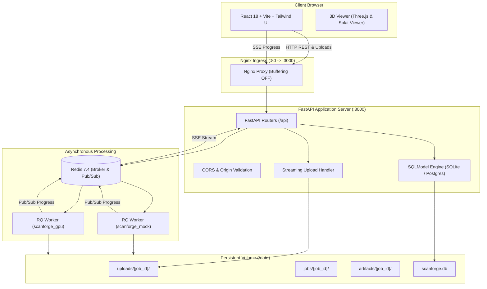
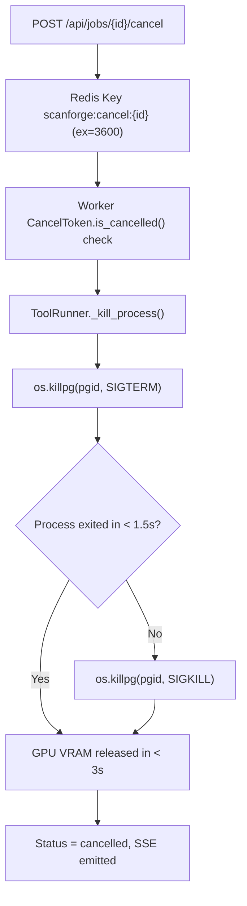

# ScanForge Architecture (docs/ARCHITECTURE.md)

Detailed system architecture, components, and data flow for ScanForge.

---

## 1. System Topology



---

## 2. Docker Compose Profiles

To avoid compiling heavy CUDA and C++ libraries during local frontend or API development, ScanForge isolates environments using Compose profiles:

| Profile | Active Services | Purpose |
|---|---|---|
| `mock` (Default) | `frontend`, `api`, `worker-mock`, `redis` | Rapid development with procedural 3D mock engine. |
| `gpu` | `frontend`, `api`, `worker-gpu`, `redis` | Production reconstruction with CUDA, COLMAP, OpenMVS, and Nerfstudio. |
| `test` | `test-frontend` | Frontend unit and Playwright integration tests. |

Separate RQ queues (`scanforge_mock` vs `scanforge_gpu`) ensure that tasks are dispatched strictly to workers matching the intended execution mode.

---

## 3. Pipeline Framework Abstraction

Reconstruction tasks are broken into discrete, testable `Stage` units:

```python
class Stage(ABC):
    name: str
    weight: float
    timeout_seconds: int = 7200

    @abstractmethod
    def run(self, ctx: JobContext) -> StageResult:
        ...

    def get_params_hash(self, ctx: JobContext) -> str:
        ...
```

### Stage Idempotence and Crash Recovery
- Prior to executing each stage, the framework computes a SHA-256 hash of its parameters and input artifact states (`.cache_<stage>.json`).
- If expected outputs exist in `ctx.workdir` and match the hash recorded in metadata, the stage is skipped in 0.0s.
- When `/api/jobs/{id}/resume` is invoked, the pipeline automatically skips all upstream completed stages and resumes directly from the failure/cancellation point.
- When `/calibrate` is invoked, only `ScaleStage` and downstream stages are marked dirty; upstream stages (SfM, point cloud densification, mesh reconstruction) are retrieved from cache.

---

## 4. Cross-Container Process Group Cancellation



1. **Decoupled Architecture**: `scanforge-api` and `scanforge-worker-gpu` communicate cancellation asynchronously via Redis key `scanforge:cancel:{job_id}`.
2. **Process Group Isolation**: External tools (`colmap`, `openmvs`, `ns-train`) run in dedicated process sessions (`start_new_session=True`).
3. **Guaranteed Teardown**: `ToolRunner` signals the entire process tree using `os.killpg`. If processes do not exit within 1.5 seconds, it escalates to `SIGKILL`, freeing all 8 GB GPU VRAM within 3.0 seconds.
4. **Clean State**: Jobs transition cleanly to `cancelled` (never `failed`), allowing instant idempotent resumption via `POST /api/jobs/{id}/resume`.

---

## 5. Storage Lifecycle, TTL Cleanup & Disk Space Guards

1. **Pre-Flight Disk Guard**: `POST /api/jobs` verifies `shutil.disk_usage().free >= SCANFORGE_MIN_FREE_DISK_GB` (5.0 GB default) before accepting uploads, returning `HTTP 507 Insufficient Storage` if full.
2. **Automated TTL Purge**: `cleanup_expired_jobs()` automatically deletes jobs older than `SCANFORGE_JOB_TTL_DAYS` (default 30 days).
3. **Scratch Space Purge**: `cleanup_job_scratch_files(job_id)` removes raw `.npy` depth maps, `.dmap` files, and intermediate point clouds, reclaiming `> 80%` disk space per completed job while strictly preserving deliverables (`mesh.glb`, `model.splat`, `preview_textured.glb`, `floor_plan.*`, `quality_report.json`, and `sparse_txt/`).
