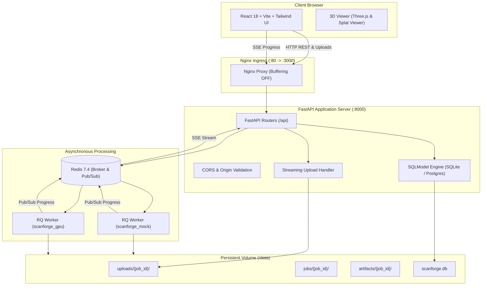

# ScanForge Architecture (docs/ARCHITECTURE.md)

Detailed system architecture, components, and data flow for ScanForge.

---

## 1. System Topology



---

## 2. Docker Compose Profiles

To avoid compiling heavy CUDA and C++ libraries during local frontend or API development, ScanForge isolates environments using Compose profiles:

| Profile | Active Services | Purpose |
|---|---|---|
| `mock` (Default) | `frontend`, `api`, `worker-mock`, `redis` | Rapid development with procedural 3D mock engine. |
| `gpu` | `frontend`, `api`, `worker-gpu`, `redis` | Production reconstruction with CUDA, COLMAP, OpenMVS, and Nerfstudio. |
| `test` | `test-frontend` | Frontend unit and Playwright integration tests. |

Separate RQ queues (`scanforge_mock` vs `scanforge_gpu`) ensure that tasks are dispatched strictly to workers matching the intended execution mode.

---

## 3. Pipeline Framework Abstraction

Reconstruction tasks are broken into discrete, testable `Stage` units:

```python
class Stage(ABC):
    name: str
    weight: float
    timeout_seconds: int = 7200

    @abstractmethod
    def run(self, ctx: JobContext) -> StageResult:
        ...

    def get_params_hash(self, ctx: JobContext) -> str:
        ...
```

### Stage Idempotence and Crash Recovery
- Prior to executing each stage, the framework computes a SHA-256 hash of its parameters and input artifact states.
- If expected outputs exist in `ctx.workdir` and match the hash recorded in metadata, the stage is skipped.
- When `/calibrate` is invoked, only `ScaleStage` and downstream stages are marked dirty; upstream stages (SfM, point cloud densification, mesh reconstruction) are retrieved from cache.
